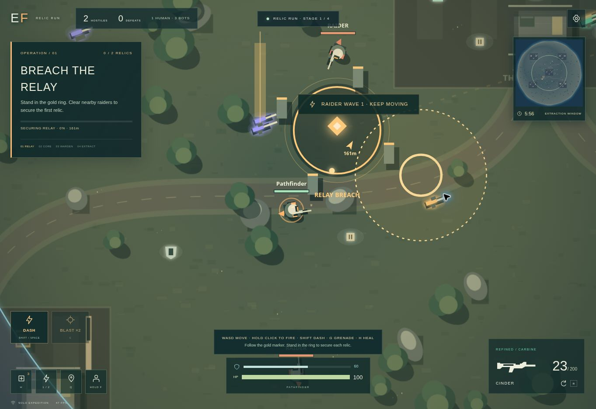

# EMBERFALL

**Run toward the danger.** An original browser action game built with ChatGPT: a solo relic expedition and a classic squad battle royale on the Cinder Coast.

[**Play the game →**](https://emberfall-squads.daintypear3.chatgpt.site/) · [Source & QA handover](https://emberfall-squads.daintypear3.chatgpt.site/handover/)



**Review the project:** [code, tests, and evidence](docs/REVIEW_GUIDE.md).

## Relic Run — start here

Start armed with a Cinder carbine, a Needle rapid weapon, armor, patches and three blast grenades. Secure two relic sites, defeat the Ash Warden and hold extraction while the raiders close in. The expedition starts locally without waiting for matchmaking. Its hard limit is six minutes; a successful skilled run can be much faster.

- **Four mission stages:** relay breach, sun core recovery, Warden encounter and extraction. Gold world markers, a route on the minimap and a live objective tracker keep the next move clear.
- **Active combat:** collision-tested dash, aimed blast grenades, scouting/ranged/elite raiders, escalating waves and a 900 HP Warden whose marked strikes intensify below half health.
- **Feedback that matters:** blast shockwaves, dash trails, enemy health bars, hit numbers, synthesized audio, kill combos and supply refills when a relic is secured.
- **A reason to retry:** fastest escape, best combo, defeat record and expedition counts save in the current browser. Relic Run grants no online XP.
- **Solo pause:** Escape stops the expedition clock. Replay creates a fresh control connection; short taps are retained until the next input tick.

| Action | Keyboard / mouse | On-screen controls |
|---|---|---|
| Move / aim / fire | WASD or arrows / mouse / hold left click | Twin sticks / hold fire |
| Dash | Shift or Space | Dash |
| Throw grenade 235 world units toward aim | G | Blast |
| Reload / heal | R / H | Reload / patch |
| Collect or replace a weapon / switch slots | E / 1 or 2 | Loot prompt / switch |
| Pause / resume expedition | Escape | Gear / Back to the Fight |

Four defeats restore a grenade. Defeats return some ammo and health; relic captures refill magazines, armor and supplies. Stay out of the Warden's red warning circles. Clear enemies near a relic ring, then stand in it until capture finishes. Earned capture progress survives a retreat.

## Classic squads

Select **Classic Squads**, then Solo, Duo or Squad. Jump from the carrier, steer your glide, loot equipment and survive six storm stages. Hold F near a knocked teammate for four seconds to revive; Q opens squad pings. Invite by link or six-character code. Bot takeover preserves disconnected squad seats.

Classic matches configure **64 combatants, at most 8 humans**; every empty seat is a disclosed bot. The full circle schedule is 8:52, with earlier elimination possible. The historical 1,000-match bot test had a 3:56 median, below the original typical 8–12 minute goal. Training is a playable 60-second local range. Settings retain audio, haptics, shake, graphics, aim assist and optional auto fire.

**Multiplayer status:** shared combat is still unverified. The cloud QA browser completed signaling but supplied zero WebRTC candidates. Physical-phone touch, audio, thermals and 60 FPS also require real-device testing. Relic Run is a local solo mode and needs no peer connection.

## Engineering

| Layer | Implementation |
|---|---|
| Rules | Pure, seeded TypeScript; 20 Hz fixed simulation; shared movement/collision and ray geometry |
| Expedition | Input-driven mission director; bounded waves/actors, one-shot ability sequences, telegraphed area attacks and explicit terminal states |
| Presentation | Canvas island cache, culled code-drawn actors, particles, lighting, minimap; procedural Web Audio |
| Classic transport | Peer-authoritative WebRTC star; intent validation, movement prediction/reconciliation, remote interpolation, 10 Hz interest-filtered state, up to 150 ms historical hits |
| Persistence | Worker + D1 for guest identity, parties, signaling, checkpoints/leases and idempotent host-attested cosmetic XP; browser-local expedition records |
| UI | React + TypeScript, Vinext/Vite; responsive twin sticks, safe-area padding and fullscreen requests where supported |

The classic host is trusted and can cheat. This is the original brief's measured fallback, not secure server authority. Production probes found isolated WebSocket state, a mean 573 ms D1 state cycle and no provisioned Durable Object binding. D1 is never used for combat polling. WebRTC uses the external Cloudflare STUN service, a documented exception to the same-origin runtime rule; there is no TURN relay. Game assets and HTTP APIs are same-origin. No purchases, ads, analytics, free-text chat or external game art/audio requests.

## Develop

Use Node 24+ and the pinned pnpm version in `package.json`.

```bash
npm install -g pnpm@11.25.0
pnpm install --frozen-lockfile
npm run dev
```

The solo expedition and training need no database. Apply the checked-in D1 migrations for local session/profile/party API testing. Keep applied migrations immutable. The existing Sites deployment is identified in `.openai/hosting.json`; do not reuse its project ID when creating an independent Site.

```bash
npm test
npm run check
node --experimental-strip-types tests/adventure-soak.mjs 1000
node tests/network-benchmark.mjs
node --expose-gc tests/soak.mjs
```

**Executed on 2026-10-29:** 34 unit/real-SQL service tests passed; clean TypeScript/build validation; 1,000 expedition runs at 20 Hz completed with zero invalid/stuck endings. The expedition harness uses 800 ideal-aim input pilots and 200 idle players. All 800 pilots extracted; idle players lost. The pilots' median was 38.8 seconds. This is functional coverage, not a human win-rate or pacing estimate. Historical classic soak and network-model evidence are dated separately in `QA.md`.

## Source map

- `game/adventure.ts`: Relic Run director, enemy input policy, abilities, objectives, boss and extraction.
- `game/simulation.ts`, `game/data.ts`: combat, inventory, geometry, classic bots, squads and storm rules.
- `game/engine.ts`, `game/renderer.ts`, `game/audio.ts`: controls, prediction, original code-drawn visuals and synthesized sound.
- `game/network.ts`, `worker/service.ts`: local/network match lifecycle, WebRTC and validated persistence APIs.
- `tests/`: unit/service coverage, expedition input pilot, historical classic soak and synthetic network/load benchmarks.
- `scripts/package-handover.py`: rebuild the downloadable source/evidence archive from authored files.

## Evidence and provenance

`QA.md` records passes and open gates. `ASSETS.md` records generated key art and genuine screenshot provenance. `DECISIONS.md` explains the hosting and game-design choices; `STATE.md` is the continuation checkpoint. `SUBMISSION.md` has counted showcase copy. The original three 1800×1200 covers remain historical live captures; cover 3 explicitly shows actual bot champions in spectator view. No player-owned victory is fabricated.

The generated `/public/handover` copies and ZIP are a delivery build; regenerate them from source. The GitHub source export omits that duplicate build and retains all authored game code, key art, covers, documents and QA evidence. A workflow checks TypeScript and tests on pushes. Its remote result must be inspected separately; local passing checks do not imply GitHub Actions has run.

